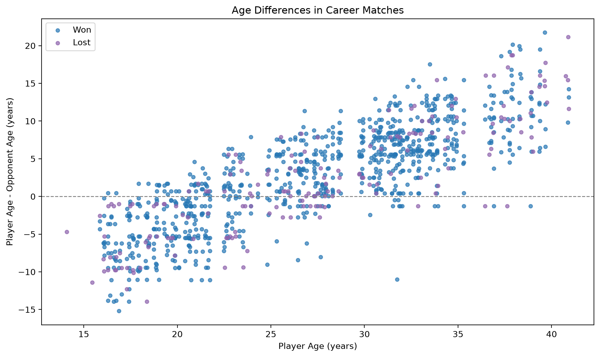
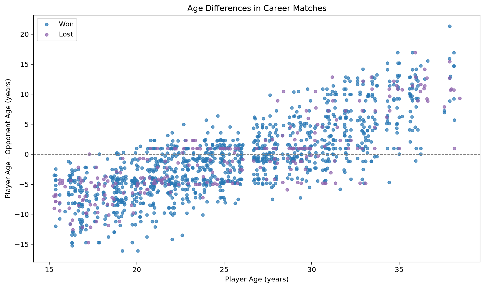

# HW 3 Tennis Career Age Visualization Package

## Homework Overview

For this homework, I created a Python package that retrieves tennis players' career match data from Tennis Abstract and produces a scatter plot showing the age differences between players and their opponents.

This assignment builds on HW2, where I reproduced a New York Times visualization of Serena Williams's professional matches. Instead of creating a plot for only Serena Williams, I organized the code into a reusable package that can work with different players, such as Serena Williams and Rafael Nadal.

The package uses Python, pandas, matplotlib, and requests to download, clean, and visualize the data.

## Project Structure

```text
hw03-judy8585/
├── src/
│   └── tennis_age/
│       ├── __init__.py
│       ├── data.py
│       ├── cleaning.py
│       └── plotting.py
├── tests/
│   ├── test_cleaning.py
│   ├── test_data.py
│   └── test_plotting.py
├── figures/
│   ├── serena_hw3.png
│   └── nadal_hw3.png
├── pyproject.toml
├── .gitignore
├── instructions.md
└── README.md
```

**src/tennis_age/** contains the Python package.

- `__init__.py` makes the main functions available to users.
- `data.py` retrieves career match data from Tennis Abstract.
- `cleaning.py` cleans the match records and calculates player ages, opponent ages, and age differences.
- `plotting.py` creates scatter plots showing the age differences in career matches.

**tests/** contains automated tests for the package.

- `test_cleaning.py` tests data cleaning and age calculations.
- `test_data.py` tests player names, data retrieval logic, and invalid inputs.
- `test_plotting.py` tests scatter plot creation, match results, and age difference direction.

The tests use mock data instead of making requests to the live website.

**figures/** contains two example visualizations generated by the package.

- `serena_hw3.png` shows Serena Williams's career matches.
- `nadal_hw3.png` shows Rafael Nadal's career matches.

**Other Files**

- `pyproject.toml` lists the package information and required Python dependencies.
- `.gitignore` excludes temporary files, Python cache files, and Jupyter checkpoints.
- `instructions.md` contains the homework instructions.
- `README.md` describes the package and how to use it.

## How to Reproduce

### 1. Install the Package

Install the package directly from GitHub:

```bash
python -m pip install git+https://github.com/UCB-stat159-f26/hw03-judy8585.git
```

Alternatively, clone the repository and install it locally:

```bash
git clone https://github.com/UCB-stat159-f26/hw03-judy8585.git
cd hw03-judy8585
python -m pip install -e .
```

### 2. Retrieve the Match Data

The `get_player_data()` function downloads and cleans career match data for a given tennis player.

```python
from tennis_age import get_player_data

serena = get_player_data("Serena Williams")
nadal = get_player_data("Rafael Nadal")
```

The function returns a pandas DataFrame containing match dates, player ages, opponent ages, age differences, results, and opponent names.

It also accepts different name formats, such as `"serena williams"` and `"SerenaWilliams"`.

An invalid player name produces a meaningful error message.

### 3. Generate the Visualizations

The `plot_player_matches()` function creates a scatter plot from the cleaned match data.

```python
from tennis_age import get_player_data, plot_player_matches

serena = get_player_data("Serena Williams")
serena_fig = plot_player_matches(serena)
serena_fig.savefig("serena_plot.png")

nadal = get_player_data("Rafael Nadal")
nadal_fig = plot_player_matches(nadal)
nadal_fig.savefig("nadal_plot.png")
```

The x-axis represents the player's age, and the y-axis represents the player's age minus the opponent's age. Blue points represent wins, while purple points represent losses.

### 4. Run the Tests

To install the package with the testing dependency from the cloned repository, run:

```bash
python -m pip install -e ".[test]"
```

Run all automated tests using:

```bash
python -m pytest tests/ -v
```

The package includes 22 automated tests for data cleaning, data retrieval, and plotting. All 22 tests passed during development.

The tests use mock JavaScript match data, so they do not need to access the live Tennis Abstract website.

## Example Visualizations

The following visualizations were generated using the package.

### Serena Williams



### Rafael Nadal



Both scatter plots show how the age differences between players and their opponents change throughout their careers.

## Data Source

The career match data come from [Tennis Abstract](https://www.tennisabstract.com/).

Example data sources:

- [Serena Williams Career Data](https://www.tennisabstract.com/jsmatches/SerenaWilliamsCareer.js)
- [Rafael Nadal Career Data](https://www.tennisabstract.com/jsmatches/RafaelNadalCareer.js)

The data are downloaded programmatically using the package.

Female and male player records use different formats for opponent ages. Some records include the opponent's date of birth, while others provide the opponent's age directly. The cleaning functions handle both formats.

## Tools Used

- Python
- pandas
- matplotlib
- requests
- pytest
- setuptools
- Git and GitHub

## Personal Reflection

Through this assignment, I learned how to turn my HW2 code into a reusable Python package. I learned how to organize my code into different functions and files so that other people can use the package for different tennis players.

One challenge was working with the different data formats from Tennis Abstract. Female and male player records store opponent age information differently, so I had to handle both cases when cleaning the data. I also found that the original career data I downloaded for Rafael Nadal did not include all of his matches. I had to check other data sources and update my function to retrieve more complete records. This taught me that getting the correct data is just as important as creating the visualization.

Another important thing I learned was automated testing. At first, I mainly checked whether my code produced the expected results. Through this assignment, I learned how to write tests using mock data and check different cases, including invalid inputs and age calculations. The tests also helped me identify problems with the plotting function. I now understand why automated tests are useful for making code more reliable.

Finally, I gained more experience with Python package installation and Git. Testing the package directly from GitHub helped me understand how other people would install and use my code. Overall, this assignment helped me learn how to make my code more organized, reusable, and easier to test.